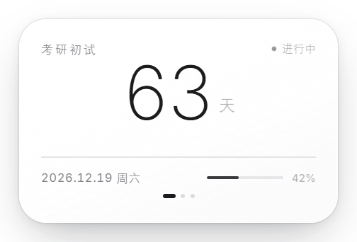
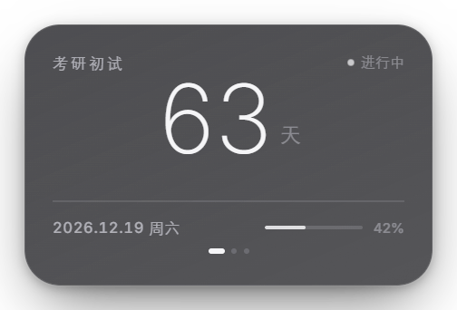
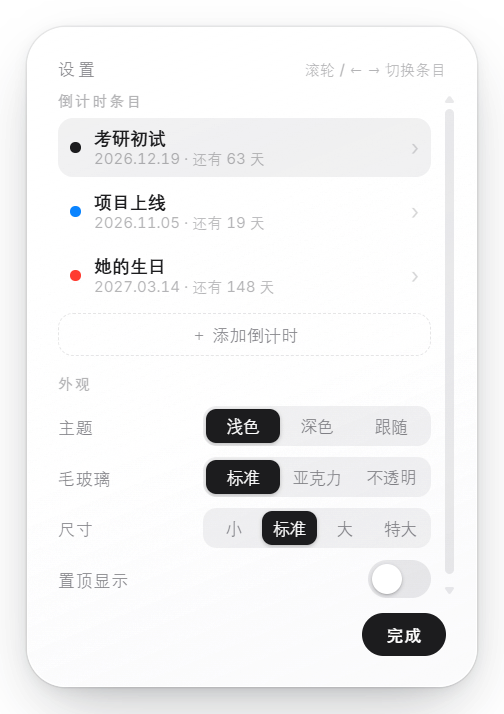
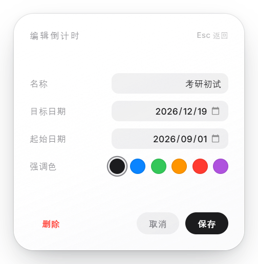

# Countdown · 桌面倒计时挂件

一个安安静静待在 Windows 桌面上的倒计时小组件：毛玻璃卡片、纤细大字、没有多余装饰。

**[English](README.md)**



| 深色 | 强调色 |
| --- | --- |
|  |  |



---

## 特性

- **无边框毛玻璃卡片** —— 26px 大圆角、1px 细描边、柔和投影，贴在桌面上不挡事。
- **多个倒计时** —— 考研、生日、项目截止……滚轮、`←` `→`、卡片下方圆点、托盘菜单都能切换。
- **每条独立强调色** —— 大数字、状态点、进度条一起跟着变。
- **浅色 / 深色 / 跟随系统**。
- **缩放 80%–180%** —— `Ctrl` + 滚轮，或直接选 小/标准/大/特大。窗口和字体同步缩放，版式不会走形。
- **随手拖动**，位置自动记住。
- **常驻托盘** —— 单击显隐，右键设置 / 置顶 / 开机自启 / 退出。

## 下载

到 [Releases](../../releases) 取最新构建：

| 文件 | 说明 |
| --- | --- |
| `Countdown-*-portable.exe` | 单文件，约 96 MB，免安装，随便放 |
| `Countdown-*-win-x64.zip` | 免解压目录版。单文件版报临时目录错误时用这个 |

`config.json` 会生成在 exe 旁边，整个程序是绿色便携的。

> 未签名构建 —— 首次运行 Windows SmartScreen 可能拦一下，点 **更多信息 → 仍要运行**。

## 操作

| 操作 | 效果 |
| --- | --- |
| 拖动卡片 | 挪位置（位置会记住） |
| **滚轮** | 切换到上一条 / 下一条倒计时 |
| `←` / `→` | 同上，键盘操作 |
| **Ctrl + 滚轮** | 整体放大 / 缩小 |
| **双击卡片** | 打开设置 |
| **右键** 卡片或托盘图标 | 弹出菜单 |
| `Esc` | 后退（在主界面则隐藏到托盘） |
| `Enter` | 打开设置（在主界面时） |

## 设置

双击卡片，分三块：

- **倒计时条目** —— 列表。点一行进去改：名称、目标日期、起始日期（可选，用来算进度条）、强调色。**＋ 添加倒计时** 新增，**删除** 移除。
- **外观** —— 主题、毛玻璃模式、尺寸、置顶。
- **三种毛玻璃** —— `标准`（真实 26px 圆角 + 半透明白卡）· `亚克力`（Windows 11 系统级背景模糊）· `不透明`（纯色兜底，透明窗口在你的机器上闹脾气时用）。



## 配置文件

所有状态都在 exe 旁边的 `config.json`：

```json
{
  "version": 2,
  "items": [
    {
      "id": "i1",
      "title": "考研初试",
      "targetDate": "2026-12-19",
      "startDate": "2026-09-01",
      "accent": "#1C1C1E"
    }
  ],
  "activeId": "i1",
  "theme": "light",
  "glass": "css",
  "scale": 1,
  "alwaysOnTop": false,
  "openAtLogin": false,
  "bounds": null
}
```

| 字段 | 含义 |
| --- | --- |
| `title` | 卡片左上角的名字 |
| `targetDate` | 倒数的目标日（`YYYY-MM-DD`） |
| `startDate` | 可选。进度条 =（今天 − 起始）/（目标 − 起始） |
| `accent` | `#1C1C1E` `#0A84FF` `#34C759` `#FF9500` `#FF3B30` `#AF52DE` 之一 |
| `theme` | `light` \| `dark` \| `auto` |
| `glass` | `css` \| `acrylic` \| `solid` |
| `scale` | `0.8` – `1.8` |

旧版单条倒计时的配置会自动迁移，不会丢数据。

## 从源码构建

```bash
npm install
npm run verify      # 语法 + 渲染逻辑自检（无需显示器）
npm run dragtest    # 拖拽 / 缩放回归测试
npm start           # 源码模式运行
npm run dist        # 打包到 dist/
```

字体：[Inter](https://github.com/rsms/inter)（woff2，OFL 协议）。中文回落系统字体（等线 / 微软雅黑）。

## 疑难杂症

**`Error writing temporary file. Make sure your temp folder is valid.`**
单文件版启动时要把自己解压到 `%TEMP%`。如果那个目录被策略限制或不可写，把 `launcher-compat.bat` 放到 exe 旁边双击它（会把 `TEMP` 指到 exe 旁边），或者改用免解压的 zip 版。

**双击之后什么都没出现。**
某些受限环境（容器化会话、特定安全策略）里 Chromium 的进程沙箱起不来。给 exe 加上参数 `--no-sandbox` 再运行。

**`Cannot read properties of undefined (reading 'setPath')`**
环境里有 `ELECTRON_RUN_AS_NODE`，Electron 被当成纯 Node 跑了。清掉即可：`set ELECTRON_RUN_AS_NODE=`。

## 平台

Windows 10/11 x64。基于 Electron —— 托盘图标、亚克力背景、无边框透明窗口这些外壳集成都是 Windows 专属。

## 许可

[MIT](LICENSE)
